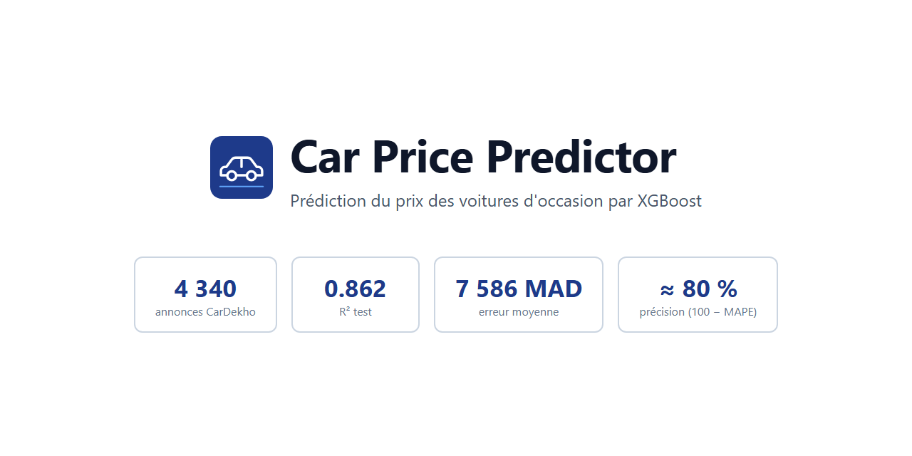
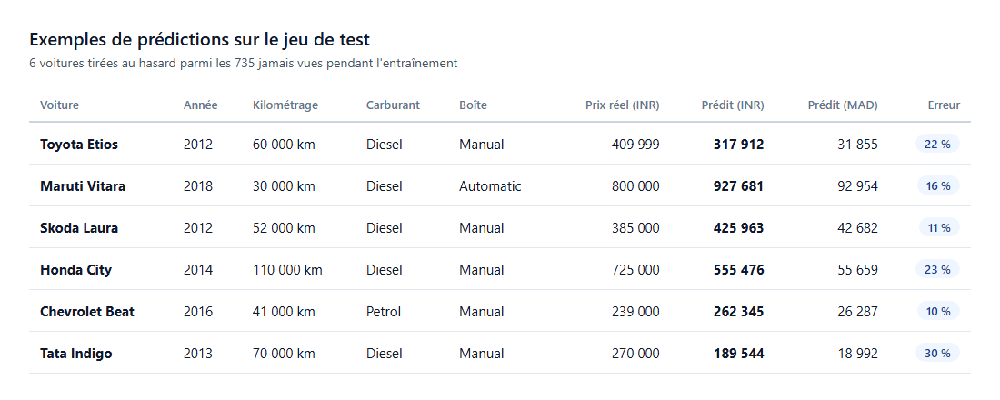
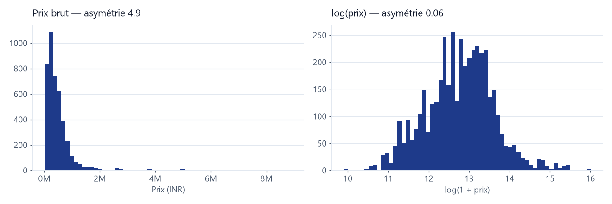
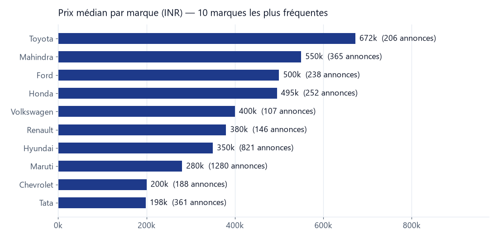
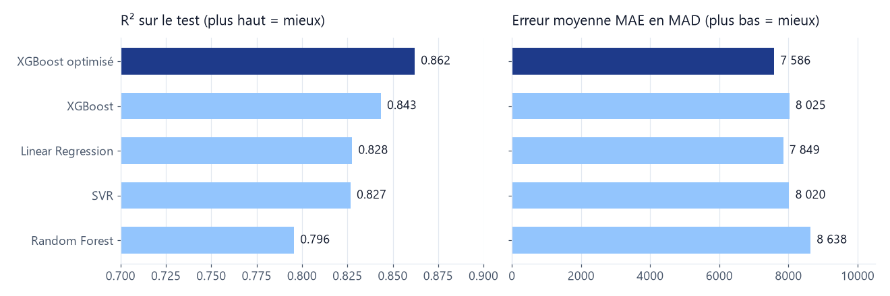
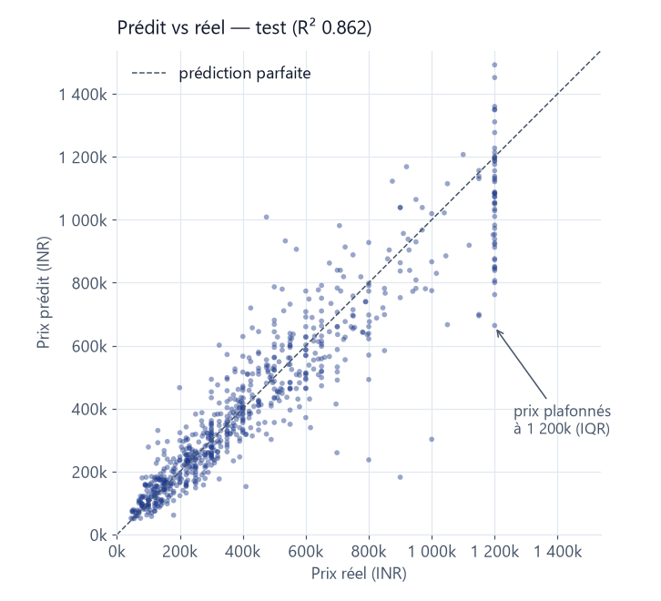
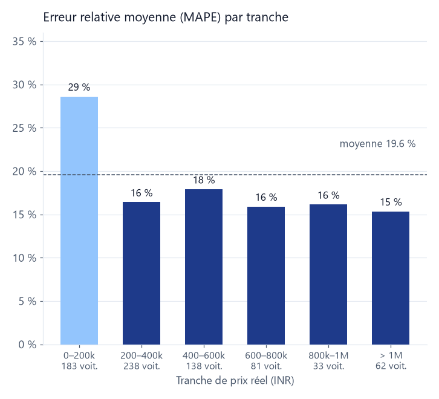
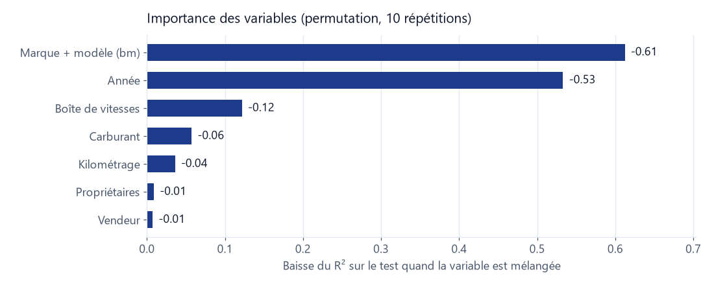

<p align="center">
  
</p>

# Car Price Predictor

Prédiction du prix de revente (`selling_price`) d'une voiture d'occasion à partir de ses
caractéristiques : marque, modèle, année, kilométrage, carburant, boîte de vitesses, type
de vendeur et nombre de propriétaires.

Projet de Machine Learning de bout en bout : nettoyage, feature engineering, comparaison
de quatre modèles de régression, optimisation d'un XGBoost avec `GridSearchCV`, analyse des
erreurs et script de prédiction.

**Résultat :** R² de **0.862** sur le jeu de test, erreur moyenne de **7 586 MAD**
(75 706 INR), soit une précision d'environ **80 %** (100 − MAPE).

<p align="center">
  
</p>

## Sommaire

- [Données](#données)
- [Préparation](#préparation)
- [Modèles](#modèles)
- [Résultats](#résultats)
- [Installation](#installation)
- [Utilisation](#utilisation)
- [Structure](#structure)
- [Limites](#limites)

## Données

Dataset **CarDekho** : 4 340 annonces de voitures d'occasion vendues en Inde, fichier
`data/raw/car_price.csv`.

| Colonne | Description |
|---|---|
| `name` | Nom complet : marque, modèle et version (`Maruti Swift Dzire VDI`) |
| `year` | Année de mise en circulation |
| `selling_price` | **Prix de vente en roupies indiennes (INR), variable à prédire** |
| `km_driven` | Kilométrage |
| `fuel` | Carburant : Diesel, Petrol, CNG, LPG, Electric |
| `seller_type` | Vendeur : Individual, Dealer, Trustmark Dealer |
| `transmission` | Boîte : Manual, Automatic |
| `owner` | Nombre de propriétaires précédents : First, Second, Third, Fourth & Above, Test Drive Car |

Les prix sont exprimés en INR et convertis en dirhams avec **1 MAD = 9.98 INR**.

Les prix sont très asymétriques : la plupart des voitures valent moins de 600 000 INR,
quelques-unes dépassent 5 millions. Le logarithme du prix a une distribution presque
symétrique, d'où le choix de prédire `log(prix)`.

<p align="center">
  
</p>

La marque joue fortement sur le prix : une Toyota d'occasion vaut en médiane plus de
trois fois une Tata.

<p align="center">
  
</p>

## Préparation

| Étape | Script | Traitement |
|---|---|---|
| Nettoyage | `src/step1/cleaning/data_cleaning.py` | chaînes vides → valeurs manquantes, imputation (médiane pour `year` et `km_driven`, mode pour `fuel`, `seller_type`, `owner`), suppression de 668 doublons |
| Feature engineering | `src/step1/cleaning/data_cleaning.py` | `bm` = marque + modèle (deux premiers mots de `name`), 189 valeurs distinctes |
| Outliers | `src/step1/cleaning/outliers.py` | règle IQR, valeurs ramenées aux bornes avec `clip` sur `selling_price`, `km_driven` et `year` |
| Encodage | `src/step1/encoding/encode_categorical.py` | one-hot pour `fuel`, `seller_type`, `transmission`, `bm` ; `owner` ordinal (0 à 3) ; `bm_code` numérique |
| Split | `src/step1/splitting/split_dataset.py` | 80/20, `random_state=42` : 2 937 voitures en train, 735 en test |
| Scaling | `src/step1/scaling/scale_features.py` | `StandardScaler` ajusté sur le train uniquement |

Après nettoyage : **3 672 voitures** et **203 variables** après encodage.

Deux choix font l'essentiel du score :

1. **Garder la marque et le modèle (`bm`).** Le prix dépend surtout du modèle de voiture.
   Sans `bm`, XGBoost plafonne à un R² de 0.55 ; avec, il monte à 0.84 (+29 points).
2. **Prédire `log(prix)`.** Le modèle apprend sur `log1p(prix)` et la prédiction est
   reconvertie avec `expm1`. Il minimise ainsi l'erreur relative plutôt que l'erreur
   absolue : une erreur de 50 000 INR ne pèse pas pareil sur une voiture à 100 000 et sur
   une voiture à 1 million.

## Modèles

Quatre modèles de base, entraînés sur `log(prix)` dans un pipeline avec `StandardScaler` :
Régression Linéaire, Random Forest, XGBoost et SVR. XGBoost est le meilleur ; il est
ensuite optimisé avec `GridSearchCV` (5 folds, 24 combinaisons, erreur quadratique sur
`log(prix)`) :

| Hyperparamètre | Valeurs testées | Retenue |
|---|---|:---:|
| `learning_rate` | 0.05, 0.1 | **0.1** |
| `max_depth` | 4, 6, 8 | **4** |
| `n_estimators` | 300, 600 | **600** |
| `subsample` | 0.7, 1.0 | **0.7** |

Le modèle final est réentraîné sur tout le train avec ces paramètres et sauvegardé dans
`models/model.pkl`.

## Résultats

Tous les scores sont calculés sur le jeu de test (735 voitures jamais vues), après
reconversion des prédictions en prix réel.

| Modèle | R² | MAE (INR) | MAE (MAD) | RMSE (INR) |
|---|:---:|:---:|:---:|:---:|
| Régression Linéaire | 0.828 | 78 335 | 7 849 | 130 047 |
| Random Forest | 0.796 | 86 212 | 8 638 | 141 605 |
| XGBoost (défaut) | 0.843 | 80 090 | 8 025 | 123 920 |
| SVR | 0.827 | 80 043 | 8 020 | 130 376 |
| **XGBoost optimisé** | **0.862** | **75 706** | **7 586** | **116 317** |

<p align="center">
  
</p>

L'optimisation fait passer XGBoost de 0.843 à **0.862** de R² et réduit l'erreur moyenne
de 4 384 INR (environ 440 MAD) par voiture.

<p align="center">
  
  
</p>

L'erreur relative moyenne (MAPE) est de **19.6 %**, l'erreur médiane de **14.6 %**. Elle
est stable autour de 15 à 18 % sur l'essentiel du marché ; seules les voitures à moins de
200 000 INR sont nettement moins bien prédites (29 %), car un petit écart en valeur y
représente un grand écart en pourcentage.

<p align="center">
  
</p>

Importance mesurée par permutation sur le test : chaque variable est mélangée à son tour
(toutes ses colonnes one-hot ensemble) et on mesure la perte de R². Le modèle de la voiture
et son année expliquent l'essentiel du prix, loin devant la boîte de vitesses, le
carburant et le kilométrage.

## Installation

```bash
git clone https://github.com/doughmi-ilyas/car-price-predictor.git
cd car-price-predictor
python -m venv .venv
.\.venv\Scripts\Activate.ps1
pip install pandas numpy scikit-learn xgboost matplotlib joblib
```

Python 3.10 ou plus récent.

## Utilisation

Toutes les commandes se lancent depuis la racine du projet.

Relancer toute la chaîne en une commande :

```bash
python scripts/run_all.py
```

Ou étape par étape :

```bash
# Étape 1 : préparation des données
python src/step1/cleaning/data_cleaning.py
python src/step1/cleaning/outliers.py
python src/step1/encoding/encode_categorical.py
python src/step1/splitting/split_dataset.py
python src/step1/scaling/scale_features.py

# Étape 2 : quatre modèles de base
python src/step2/training/train_models.py
python src/step2/evaluation/show_results.py

# Étape 3 : optimisation et réentraînement
python src/step3/optimization/optimize_xgboost.py
python src/step3/retrain/retrain_best.py

# Étape 4 : évaluation
python src/step4/evaluation/compare_models.py
python src/step4/evaluation/analyze_errors.py

# Étape 5 : prédiction
python src/step5/predict.py
```

`predict.py` affiche d'abord une démo sur cinq voitures du dataset, puis pose les
questions (marque, modèle, année, kilométrage, propriétaires, carburant, vendeur, boîte).
Entrée garde la valeur par défaut :

```text
=== PREDICTION D'UNE NOUVELLE VOITURE ===
(appuie sur Entree pour la valeur par defaut)
Marque (defaut Maruti) : Hyundai
Modele (defaut Swift) : i20
Annee (defaut 2017) : 2016
Kilometrage (defaut 50000) :
Owner (defaut First Owner) :
Fuel - Petrol/Diesel/CNG/LPG/Electric (defaut Diesel) :
Seller type - Dealer/Individual/Trustmark Dealer (defaut Individual) :
Transmission - Manual/Automatic (defaut Manual) :

Prix estime : 638,295 INR (~63,957 MAD)
```

Un modèle absent du dataset n'active aucune colonne `bm_*` et reçoit un nouveau
`bm_code` : la prédiction s'appuie alors sur les autres caractéristiques et elle est moins
précise.

## Structure

```text
car-price-predictor/
├── assets/                    # Images du README
├── data/
│   ├── raw/car_price.csv      # Dataset brut
│   ├── processed/             # Données nettoyées, encodées, splittées (généré)
│   └── models/                # Scores, paramètres, graphiques (généré)
├── models/model.pkl           # Modèle final : XGBoost optimisé
├── scripts/run_all.py         # Lance toute la chaîne dans l'ordre
└── src/
    ├── step1/                 # Exploration, nettoyage, encodage, split, scaling
    ├── step2/                 # Modèles de base
    ├── step3/                 # GridSearchCV et réentraînement
    ├── step4/                 # Comparaison et analyse des erreurs
    └── step5/predict.py       # Prédiction interactive
```

`data/processed/` et `data/models/` sont ignorés par git et recréés par les scripts.
`models/model.pkl` est versionné pour pouvoir prédire sans relancer l'entraînement.

## Limites

- L'état réel du véhicule (accidents, entretien, options, version exacte) n'est pas dans
  le dataset. Une partie de l'erreur, de l'ordre de 15 %, est difficile à réduire avec ces
  seules variables.
- Les prix au-dessus de 1 200 000 INR (174 voitures sur 3 672) sont ramenés à cette
  borne par la règle IQR. Le modèle sous-estime donc les voitures haut de gamme, et les scores du test
  sont calculés sur ces prix plafonnés.
- Les voitures à moins de 200 000 INR restent les plus difficiles à prédire en
  pourcentage (29 % d'erreur).
- Pistes d'amélioration : recherche d'hyperparamètres plus large (Optuna), stacking avec
  LightGBM, interface web avec Streamlit.
